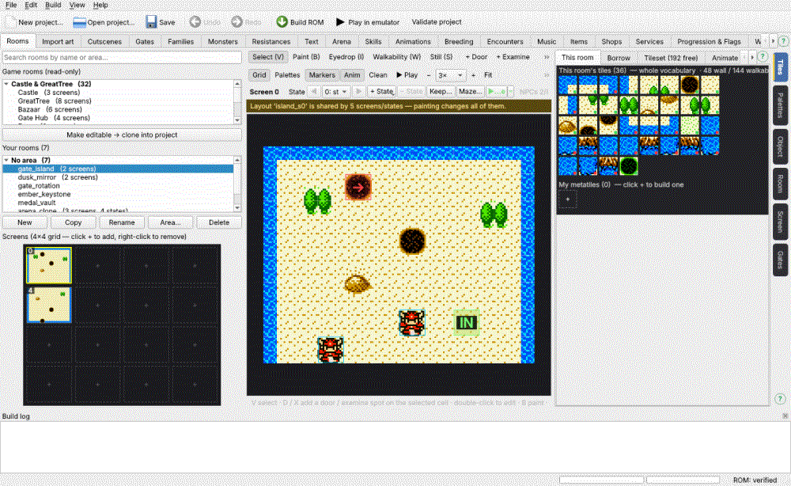

# Rooms, screens and states

**New room:** Rooms tab → **New** under the room list → name + the game
room whose tileset it uses — or a **gate theme** (one of the 16 maze looks of
the gates, in their colours: see *Gate themes*). **Copy / Rename / Area… / Delete** sit next to it. A
game room is read-only until you **Make editable** (it is copied into the
project).

**Rooms by name (S143).** The editor shows every room — yours and the game's — by its
NAME only, never a map id or a region: in the room lists, in every place you pick a
room (doors, teleports, conversation and cutscene moves, gates, the hub, worlds, the
arena, Borrow, Import art, music), in the World tab and in the Build log. So room names
are **unique**: New / Copy / Make editable pick a free name ("Cave 2" when there is a
"Cave"), and Rename refuses a name another room has. A project saved with two rooms of
one name gets the second renamed ("GreatTree 2") when it opens (the Build log says so —
Save to keep it). The game's own rooms keep the names you know; the eight unused map
ids that only hold the Castle's room data are listed as **Castle (unused copy 1-8)**,
and the copy of the gate item shop's data as *Gate Floor: Item Shop (unused copy)*.
When one of your rooms has the same name as a game room (a copy keeps the game's name),
the game's is shown as "GreatTree (game room)". **View → Show technical ids** puts each
room's map id (and region, "region 1 $6B") after its name everywhere, for debugging in
SameBoy — off by default; the stored destinations never change.

**Areas (S143):** one level of named folders for your rooms. The room list shows each
area as a folder with its room count ("No area" last); **Area…** (or right-click a room
→ *Put in area… / Move to*), the **area** box on the Room page, or dragging a room onto
a folder moves it; type a new name to make a new area. Right-click a folder to rename,
move up / down or delete an area (its rooms stay, with no area). The **search box**
above the lists filters your rooms and the game's by name or area. Every room picker
lists your rooms by area, and the World tab can show one area. Areas are only for you
— the game never sees them.

**Picking a room (S143):** every room choice is one searchable list — click it and pick,
or TYPE any part of a name or an area and choose from what matches (Enter / click). Your
rooms come under their areas, the game's rooms under their groups (Castle & GreatTree,
Arena & Starry Shrine, Travelers' gate rooms, Boss rooms, Gate floors & mazes).

**Copy** (S142) makes a room of its own: its own screens, its own tileset copy,
its own **scripts and texts** (change what a copied NPC says and the original
still says its old words — before S142 a copy's NPCs ran the original's
scripts, and a copied breeder stopped the build) and its own **doors**, which
start **unconnected** (a door leads both ways, so the original's partner door
keeps leading to the original): connect them where the copy should lead. The
status line says how many. A quest stays with the original giver (the copy's
NPC keeps the giver's own conversation, without the quest); flags are not
copied — a copied conversation turns the same flags on as the original.

**Screens:** a room is up to a 4×4 grid of screens (10×8 cells each). The
mini-map shows them; click a **+** square to add a screen, click a screen
to show it.

A room is always a full rectangle of screens (S149): walking into a screen
inside the room's size that was never made showed stray tiles in the game.
So adding a screen also adds blank screens wherever the new rectangle would
have a gap (the status line names them; one Undo removes them all), and a
screen whose removal would leave a gap — the middle of a row, a corner of a
2 × 2 room — is not removed (remove the screens at the edge first, or paint
it as a wall). A project made before S149 with such a gap gets a WARNING in
the open log naming the room and the screens. A copy of one of the game's
rooms (Make editable) keeps the original room's shape — its gaps are walled
off in the game, so they are left alone and not reported.

**Copy / paste a screen (S175)** — a backup of a screen's art in another screen of the
same room. Right-click a screen on the mini-map → **Copy screen** (or the **Copy screen**
button under the mini-map, **⌘⇧C**): its tiles (walkability comes with them — it is the
tiles'), its colours (palette slots + the palette it shows) and its **stamps**, in the
state shown, are kept as they are NOW. Then right-click another screen of the room →
**Paste over screen N** (or **Paste here**, **⌘⇧V**): that screen (the state shown) gets the
copied art — and keeps everything else: its NPCs, examine spots, triggers, jumps, doors,
exits, cutscenes, scripts and states. Its stamps are replaced by the copied ones. One Undo
puts it back. A paste goes only into a screen of the room it was copied from, and only a
screen that exists (add it first). Tip: keep a spare screen (an empty corner of the grid
nobody walks to) as the bank — remember it is still part of the room the player walks in.

**Shift objects ◀ ▶ ▲ ▼ (S175)** — under the mini-map (or right-click a screen → *Shift
objects*): moves EVERYTHING placed on the screen one cell — NPCs, examine spots, step-on
triggers, jumps, statues, monuments, archives, doors and exits, stamps, and its cutscenes'
places (trigger cell, start, walks, appear / fly targets, tile pieces) — in every state;
and every ARRIVAL into the screen from anywhere follows: doors and exits of any room that
lead here, routed game doors, cutscene / conversation / talk moves, the Milly arrival, the
new game's start, the hub, gate arrivals, raw script warps. Use it after the art moved
(a pasted backup a cell off). **Edge exits** (on the left / right column or the top row:
they fire when the player pushes into the screen's edge) stay on the edge. If anything
would leave the screen (or a door would land on an edge), **nothing moves** and the
message names what is in the way. A jump from the screen above keeps its column (a jump
falls straight down) — its landing row follows an up / down shift. Raw script walks to
absolute pixels are not moved (the line says how many). One Undo puts it all back.

**A screen's own music (S175)** — the Screen page (on the right) → **music**: the song
on that screen, every state ("(the room's song)" = the room's music, set on the Room page /
the Music tab). Walking onto the screen from another screen of the room switches to its
song — **only when it is a different song**: two screens with the same song (or a screen
with the room's song next to the room) play on without restarting. Entering the room on
that screen, or loading a save made there, plays it too. The screens without a song of
their own play the room's song. Not in gates; not while a cutscene walks the player across
screens (the song changes at the next ordinary scroll); a room whose song changes by flag
(Music rules) gets a warning — its other screens play its base song after a scroll.
The list is grouped: **your songs**, the **DWM2 songs** and the **MIDI library** (picking
one of these adds it to your songs — the Music tab lists it — and assigns it, one undo
step), then **the game's songs**, named by where the game plays them (or by the name you
gave them on the Music tab). **▶** beside the list previews the selected song (■ stops).

**Jumping points (S175)** — the GreatTree cliff jump: **+ More ▸ + Jump (J)** on the
selected cell. When the player WALKS onto that cell the game plays the jump sound and
walks him straight down — through anything — to the landing cell on the **screen below**,
then scrolls there (exactly what the game's own three GreatTree jumps do). The Object
page shows the screen below: click a cell of the yellow column (or set **row**) to choose
where he lands — red crosses are walls (he would be stuck inside one). The landing is
shown on the screen below as **↓J**: drag it up or down; double-click it to go back to the
jump. **sound** ($55 = the game's), **in states** (a jump can be there only in some states —
GreatTree's first jump appears after the opening scene), **Go to the screen below**,
**Remove jump**. Rules (measured in the game): a jump always lands on the screen directly
below, in the same column — a landing on the same screen would lock the player for good,
two screens down leaves the controls odd, so the editor refuses both; a screen with no
screen below cannot have one. Warnings: the jump or landing cell is a wall; an exit on the
way down (a scripted walk onto an exit fires it). Paint the jump cell so it looks like a
ledge — players cannot see an invisible one. In the **Whole room** window every jump is an
arrow from its cell to its landing.

**Maze…** (Maze screen…, on the screen / state row) fills the shown screen and
state with one of the gates' maze screens, tiles and palette slots — see
*Gate themes*.

**The right side — pages (S132).** The tabs down the right edge each open ONE page
at full height (no scrolling through stacked sections): **Tiles** (the metatiles
to paint with, Borrow, Tileset, Animate, **Draw**), **Palettes** (the room's colours,
**Borrow palette…**, which palette the room / this screen uses), **Object** (the
selected cell, NPC, door, exit or spot — opens by itself when you click one),
**Room** (name, tileset, size, music, doors that lead here, state rules),
**Screen** (the screen / state on the canvas) and **Gates** (only for rooms used
inside gates and worlds). Engine numbers (attr grids, layout ids — and, with View →
Show technical ids, the room's id and map id) sit in a folded *Technical* box at the
bottom of Room / Screen. Your 129th room and on go into a later REGION by themselves
(see *Limits*); you never pick one. Choosing Paint or Eyedrop
opens Tiles. The editor remembers the page you used last.

**The two bars above the canvas (S173).** The **tools**: **Select (V)**, **Paint (B)**,
**Eyedrop (I)** (or right-click), **Walkability (W)**, **Still (S)** (click a moving cell, pick
a frame: that cell stops moving — see *Animated tiles*), **Stamp (T)** (a picture on top of
the tiles — see *Stamps* below),
then **+ Door (D)**, **+ Examine (X)**, **+ NPC (N)** and **+ More** — a **+ Jump (J)**
(see *Jumping points* above), the memorial
**+ Statue (U)** and the breeding-hint **+ Monument (O)** / **+ Archive (K)** (their keys
work without opening the menu). A **statue** shows a monster that won a boss battle, an
arena class or Starry Night with you and has left since (see *The memorial*); a
**monument** teaches a breeding cross the player has not found, an **archive** lists one
family's learned crosses (see *Breeding hints*). The **view**: **Grid**, **Palettes**,
**Markers**, **Anim** (overlays on / off), **Clean** — the art only, no grid, markers,
outlines or selection (or HOLD **H** on the canvas for a quick look), **▶ Play** (the
room's animation), the **zoom** (**−** / **+**, the box, **Fit** = the biggest that fits;
1× to 12× with half steps 1.5× / 2.5× — sharp on a Retina screen; also ⌘/Ctrl + wheel, a
trackpad pinch, or the + / − keys), **Whole room** and **Reference**.

**Painting:** pick a metatile (Tiles page) and paint with the canvas tools; the
**Walkability** tool shows / flips walkability. While you paint, the brush is drawn
under the mouse **before** you click (S173), so you see how it sits among its
neighbours. **Where is it used?** Hover a metatile on the Tiles page: every cell of the
screen drawn with it is outlined in magenta, and the line under the canvas counts them
(this screen, the whole room). Painting is immediate (S132: only the cells
you paint are redrawn; the side panels update once when you let go; the space
meters measure in the background — see *Capacity*).

**Borrow palette…** (Palettes page): any room's colours — one of your rooms, a
game room at any screen and step (the Servant room on fire, the night Farm …) or
a gate theme. Left: pick the room (type to filter), its screen and state; middle:
that screen in its own colours; right: YOUR screen re-coloured as it would be.
Take **the whole palette** — for the whole room or only this screen / state (your
own room's palette can be **shared** instead of copied: then a colour edit shows
in both rooms) — or **only some rows**: "my slot 2 ← their row 1". If other
places use your palette, *Only here* copies it first so they keep their colours.
One undo step. The palette combos name the rooms that use each palette.

**Draw** (Tiles page → Draw tab): paint a metatile pixel by pixel. Load the
selected cell, the brush, or a blank tile (left = paint, Shift = fill, right = pick a
colour; Ctrl+click picks a quarter for the tools: flip, shift, copy / paste, clear, undo,
redo, revert). **⌘Z / ⌘⇧Z** undo and redo your strokes while a drawing is loaded and the
Draw tab is shown (one drag = one step); otherwise they undo the project as usual. The
colours are **every row of the room**, but an 8×8 quarter is drawn in ONE row, so a
quarter is painted with its own row's colours: when you click in a quarter, the colours its
row does not have are dimmed (S171 r7). A colour another row shares with it (black, cream)
paints as its own; any other is refused with a hint — painting never moves a quarter.
Right-click picks the clicked pixel's colour in its own row. Shapes change only where you
paint. **Recolour the part** (the quarter picked under *tools act on*, or the whole tile):
**row 0-3** puts it in that row (every pixel keeps its colour number — the same shapes in
that row's colours); **Recolour…** = click a colour in the drawing, then a swatch: every
pixel of that colour in the part becomes the colour you picked. Palette edits (Palettes
page) show in the drawing at once. To change a colour itself, edit it on the Palettes page.
Then
**Redraw it everywhere it is drawn** (the tiles themselves change — the line says
how many cells in which rooms; nothing is spent) or **Save as a new metatile**
(free tileset slots, the walkable / wall side you tick; put it on the selected
cells, on every cell of the room drawing the original, or only into My
metatiles). Once a quarter moved to another row, use *Save as a new metatile* (on every
cell drawing the original): *everywhere* would leave other cells in their old row. Tiles the room animates are changed in the Animate tab; the common
font / frame tiles ($80-$AF) only as a new metatile.

**Stamps (S174):** a stamp is a picture put ON TOP of the tiles — a wall torch with its
glow, and anything like it later. The tiles under it are **never changed**: the build draws
the stamp into a copy of your project, so moving or removing a stamp leaves the tiles
exactly as they were, with no leftover tiles. The **Stamps** page (right) is the library:
**Import PNG…** (the frames side by side or one under the other, each the stamp's size in
16-pixel cells — "3x2" in the file name fills the size in; in the picture **clear** pixels
let the tiles show, **half-clear** pixels LIGHT them — their colour, except where the tiles
are black, so the grain shows through — and solid pixels are drawn), **Rename…**,
**Remove…** (from the library and every screen it is on), **Speed** (32 = the game's own
torches), **Show the stamps on the canvas** (off: the tiles under them). Choose one, then the **Stamp tool (T)**: its picture follows the mouse (the cursor
on its middle column, top row — a wall torch's flame); **click** to put it down; **drag** a
stamp to move it; **Del** removes the selected one; **⌘C / ⌘V** copy it and paste it under
the mouse — on another screen or another of your rooms too; **right-click** a stamp:
**Light** on / off (off = without its glow: a sign, a plant) and the **Light colour** (the
glow and the stamp's own glow colour inside it — a torch's hot core). Each placement has
its own light. Stamps cannot overlap (a red outline says so). It shows on the screen you
put it on only. Each step is one undo.
The canvas shows every stamp exactly as the game will draw it (▶ Play: moving). **Colours
(S174 r2):** an 8×8 piece shows 4 colours at most (one of them black), and the room's
palette has 4 rows. Putting a stamp down **writes the colour rows it needs into your
palette** — rows no tile uses yet (any room using that palette counts) — so you SEE them on
the **Palettes** page (under the rows: "Rows stamps use: row 2: Wall torch…") and can paint
tiles with them too; no other stamp takes those rows, and *Re-plan colours* starts with them
kept. Don't recolour them, or the stamp changes with them. Removing the stamp leaves the
colours in the palette. When no row is free, or a piece over busy tiles would need a 5th
colour, the **nearest** colours are used and the stamp is marked **!** — the Stamps page and
the Build log say how many pixels. A second light colour in one room usually needs rows the
room no longer has.
Over a MOVING tile (swaying bark) a stamp's pieces keep the first frame of what is under
them.

**Whole room (S173):** every screen of the room joined into one picture in a window of
its own — the screen edges dashed, the screen on the canvas outlined, the state of your
choice (or the canvas's: *Follow the canvas*), *Cell grid*, zoom / Fit, every jump as an
orange arrow (S175). It follows every
edit; double-click a screen to show it on the canvas. Use it to check that screens line
up.

**Reference (S173):** any room — the game's or yours, any screen and state — in a
window of its own beside the editor (*On top* keeps it above). It is the room canvas,
read-only: grid, markers, **▶ Play**, zoom, hold **H**. **Right-click** a cell there: it
becomes your brush when that room draws with the same tiles as the room you edit (a
copy of it, a room on the same tileset); otherwise the line says to bring it over with
**Borrow**.

**States:** a screen can have several **states** (versions) — e.g. "boss
present" and "boss beaten". **+ State** (duplicate this state, with or
without its own layout copy, or an empty state); **− State** removes the one shown; ◀ ▶
switch the state shown.

**Make editable: which states the copy keeps (S144).** A game room's screens have their
own states — the game picks one from how far its story is (GreatTree's entrance has 5:
the start of the game, the cliff scene, … the post-game). Your romhack never plays the
original story, so a copy that followed it would show its start-of-game state forever.
**Make editable** therefore opens a window with every screen's states as pictures (the
people drawn on, the exits outlined, "2 people, 1 exit" underneath): tick the states the
copy keeps and the one each screen **starts here** in. **Moment in the original
story** fills the ticks in for you:

- a town room (GreatTree, the Farm, the Castle …): **right after Starry Night** — each
  screen keeps the state the game has then, plus every state the room's own scripts can
  switch it to from there;
- a gate's boss room: **about to do its gate** — the boss here AND beaten;
- any other moment (the same list as Play here's story points), or **Every state,
  following the original game's story** (the copy as before S144: it follows the game's
  counters, and shows the start-of-game states in a new romhack).

**People talk as they did at that moment** (ticked): the copy's people check the
original game's story flags ("has the post-game started?"); every such check of a flag
the game has ON at that moment is answered when the copy is made, so the copy talks
post-game in your romhack too — and its scripts get smaller (talk branches it can never
reach are left out; the Castle's 4.3 KB → 0.5 KB). Flags the player sets (talked once,
got an item, a later gate) stay real checks. Scripts no kept state's people or spots use
are left out (their slot in the room's script list points at a one-word stub).

**A state the room's own scripts switch to is remembered** — a boss beaten stays beaten
after a save: the copy's script that switches the state also turns on a flag of its
own (named after the room, "boss_villager_dragon_s0_state1"), and a state rule shows that
state whenever the flag is on (flags are saved, a room's own state counter is not).

**Copies made before S148 are repaired when you open the project.** The copy tool
stopped copying a script at its "refresh sprites" step (the game only pauses there and
goes on), so a copy of the **Castle**, the **Starry Shrine** or a **Priest gate floor**
ran into another scene at that point (the Castle's priest never gave his Herb, the
King's post-game greeting broke; the Priest's heal ran on into his other line and kept
the healing tune). Opening the project puts the missing steps back — the log says
`MIGRATED: room … got back N step(s)` (Save to keep it). A copied script you edited
there since is left alone and reported (`WARNING: …`): make that copy again, or compare
it with the game's scene in the Cutscenes tab. Copies of every other room were
complete.

**Keep…** (Keep states…, on the state row) does the same for any room of yours with states —
a copy you made earlier with every state (your GreatTree), or a room you built: tick,
pick the start, OK; every script that names the screen's state uses the new numbers
(a state you dropped: its checks are never true, its writes are left out). Undo restores.
After it, a copy no longer follows the original game (the *Follow the game's room state*
tick is gone): its states are your own. Your arena's two rooms keep every state (the game's match
scripts switch them) — Keep states… says so. You can still **+ Add state** — e.g. a
"post-post-game" GreatTree — and show it with a state rule.

**State rules** (Room page → *State rules — which state shows when*): **Add…** a rule "show state N when these flags are ON / OFF".
Rules are checked top-down every time a screen loads; the first that holds
wins. Flags are saved with the game, so this is how a room remembers its
version. See *Boss floors → the "beaten" version*.

**A copy made with "Every state, following the original game's story" follows the
game's state** (*Follow the game's room state*, in the State rules section): its states change
when the game's story changes the original's (the Castle moves GreatTree to
"the man by the cliff"), and they are saved with the game, exactly like the
original. Untick it for a copy that should keep its own state (a copied boss
room you use for a NEW boss — otherwise beating the original boss shows the
copy beaten too). A copy with state rules uses its own state.

**Inside gates and worlds** (the **Gates** page): the room's
settings for gate floors (arrival cell, music, battles, saving, arrival
conversation, stairs) — and, for a room of a **world**, which world it belongs
to and whether the player can save there (see *Worlds*).

**Animated tiles:** select cells → Tiles page → **Animate** tab. See the
*Animated tiles* topic.
