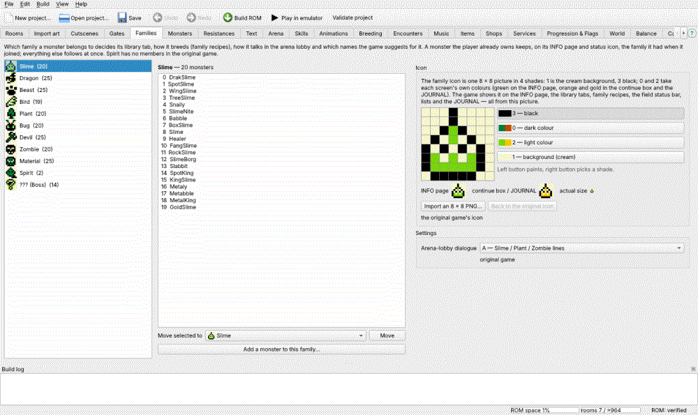

# Families

The **Families** tab: which monsters belong to which family, each family's
icon, how its monsters talk in the arena lobby, and Spirit's default names.

**Left — the 11 families** (Slime, Dragon, Beast, Bird, Plant, Bug, Devil,
Zombie, Material, **Spirit** — the 11th family this editor adds, shown before
??? as in the game's library — and ??? (the bosses)), each with its icon, name
and member count. Spirit has no members in the original game.

**Middle — the members** of the family picked. **Move selected to** + a family
+ **Move** moves monsters to another family; **Add a monster to this family…**
brings any monster in. (The Monsters tab's *Family* box does the same for one
monster — see [Monsters](52_monsters.md#Species%20page).)

What a family decides, in the game:

- the monster's **library tab** and its breeding text in the library;
- **breeding** — family recipes go by family (see [Breeding](58_breeding.md#Family%20recipes));
- how it **talks in the arena lobby**;
- which **names** the naming screen suggests for it.

All of that follows a move at once. A monster the player **already owns**
keeps, on its INFO page and status icon, the family it had when it joined.

**Right — the family's settings:**

- **Icon** — one 8 × 8 picture in 4 shades: 1 is the cream background, 3
  black; 0 and 2 take each screen's own colours (green on the INFO page,
  orange and gold in the continue box and the JOURNAL). Left button paints,
  right button picks a shade; **Import an 8 × 8 PNG…**; **Back to the original
  icon**. The previews show the INFO page, the continue box / JOURNAL and the
  actual size. The game shows it on the INFO page, the library tabs, family
  recipes, the field status bar, lists and the JOURNAL — all from this picture.
- **Arena-lobby dialogue** — which family's lines its monsters say in the arena
  lobby.
- **Spirit default names** (Spirit only) — when a monster joins or hatches, the
  naming screen fills in a name picked at random from its family's list (the
  other families use the game's own 16 names each). These are Spirit's 8 — up
  to 4 letters each.

See also the [Glossary](95_glossary.md). Every change you make on this tab is one undo step
(Edit → Undo puts the family, the icon or the names back).
