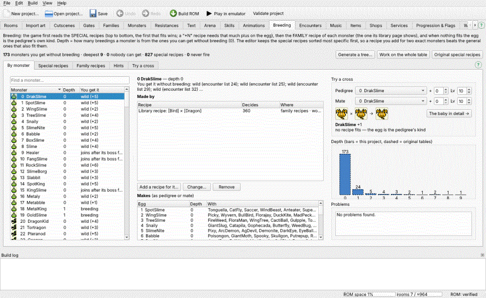
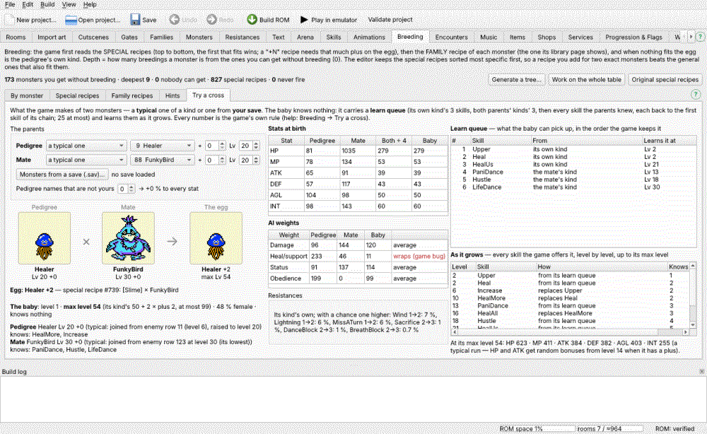

# Breeding

The **Breeding** tab edits how monsters breed and shows what the game will
really do with your recipes — every answer comes from a copy of the game's
own breeding code that was checked against the game for every pair of
parents.

## How the game decides an egg

1. **Special recipes**, top to bottom. The first one whose two parents fit
   (a monster, or a family = any monster of it) — and whose **+** the egg
   reaches — decides. It can also add plus to the egg.
2. If none fits: the **family recipe** of each monster. There is one per
   monster: it makes THAT monster, and it is the recipe its library page
   shows. A recipe naming the exact pedigree wins at once; among family
   matches the LAST one in the list wins. The mate is tried as itself first,
   then as its family.
3. If nothing fits: the egg is the pedigree's own kind.

The egg's **plus** = the higher of the parents' plus + 1, + 1 to 4 when the
parents' levels add up to 40 / 60 / 76 / 100 or more (at most 99). A
"needs +5" recipe therefore needs a plus-4 parent, or two parents whose
levels add up to 100 (plus 0 → 1 + 4). The game has no random mutation: an
unused one is in the code but nothing calls it.

**The editor keeps the special recipes sorted, most specific first:** two
exact monsters, then monster × family, then family × monster, then family ×
family, and within each a + recipe before the same parents without it. So a
recipe you add for, say, Slime × DragonKid beats the general Slime × [Dragon]
recipe for those two, and loses to nothing more general. (Sorting the
original 825 recipes this way changes no result.) Two recipes with the same
parents and the same + are refused — the second could never fire.

## By monster

The list shows every monster you can collect (0-214 and your new ones) with
its **Depth**: 0 = you can get it without breeding, 1 = bred from monsters
of depth 0, and so on; "—" = nobody can get it. **You get it** says how:
wild (a gate's encounter list, if that row can join), the starter, a boss
that joins, a gift or egg in the story (the SkyDragon egg, the farm's Slime
eggs, Watabou at the stable, StoneMan at the restaurant) or an `add_monster`
in your own scripts (egg rewards).

For the selected monster:

- **Made by** — its library (family) recipe and every special recipe that
  makes it, with how many pedigree × mate pairs each really decides. "0 —
  never fires" = a recipe above it always fits first. Hover a recipe for the
  pairs. **Add a recipe for it…**, **Change…** (or double-click), **Remove**.
- **Makes** — the eggs it gives as pedigree or mate, and with whom.
  Double-click one to go to it.

On the right:

- **Try a cross** — pick the pedigree and the mate, their plus and levels:
  the egg, its plus and which recipe decided, with the three monsters' pictures. **The baby
  in detail →** opens the
  **Try a cross** page with these two (below).
- **Depth** — how many monsters sit at each depth in your project (bars)
  and with the original recipes (dashed).
- **Problems** — monsters nobody can get, special recipes that never fire,
  library pages whose recipe never gives that monster. Double-click to go.

## Special recipes

The whole special table in the order the game reads it: pedigree, mate,
needs +, makes, adds +, where it came from (original / original, changed /
added / your table) and how many pairs it decides. Filter by a monster or a
family name. **Add…**, **Change…**, **Remove**; removed original recipes
can be brought back below the list. Changed and added recipes are bold.

## Family recipes

The 215 family recipes (one per monster, = its library page). **Change…**,
**No family recipe**, **Original recipe**. "Works for" = how many of the
parent pairs the recipe names really give that monster (a special recipe
can win first). The library page's text follows your change.

## Hints (S158)

The **Hints** page picks which special recipes the game's hint MONUMENTS teach and its
ARCHIVES list — see *Breeding hints: monuments and archives*.

## Try a cross: the baby

The **Try a cross** page shows what the game makes of two monsters — not only the egg,
but the baby itself. Every number is the game's own rule (see *Raising monsters*; checked
against the game on a real save).

**The parents.** For each, pick **a typical one** — a monster of a kind, plus and level,
made the way a monster that joins you is made (from its lowest battle row that can join)
and levelled the game's way (with more than 8 skills it keeps the first 8) — or, after
**Monsters from a save (.sav)…**, one of the party or farm monsters of a battery save of
your build: its own stats, skills, plus, level and pedigree. The editor remembers the
save. **Pedigree names that are not yours** is set from the parents (a typical parent is
yours: 0; a save's monster counts its master and, if it was bred, its parents' two
names); change it to try another case — every name adds 2 % to each stat.

**The pictures** — the pedigree × the mate → the egg, each as its battle pose the way your
project draws it: a monster you gave new art or new colours (Monsters tab → Name & art) and
your new monsters show their own pictures. Under each: its name (a save's monster: its
nickname and ♂ / ♀), level and plus; the egg's max level. Hover a parent for what it knows.
The small **Try a cross** box on the By monster page shows the three as they walk in the field.

**The egg** — its kind, plus and which recipe decided; what each parent knows.

**The baby** — level 1 and its **max level** (its kind's cap + 2 × plus) and the chance it
is female; **Resistances** — which can come out one higher, with the chance (the six most
likely; hover for all). **Stats at birth**: each parent's stat, (both) ÷ 4 and the baby's (with the
+2 % per name). **AI weights**: the average — a red **wraps (game bug)** marks a weight
whose sum went past 255 (the original code drops the carry: two 200s give 72).

**Learn queue** — the skills the baby can pick up, in the order the game keeps them,
where each came from ("the pedigree knew HealMore" = it was turned back into Heal) and
**the level it learns it**; "not by Lv …" = its level or stats never reach that skill's
needs before its max level (Skills tab → learning). **Not passed on** lists the parents'
skills that did not make it: skills the game never passes on, and any past the 25th.

**As it grows** — every skill the game offers the baby, level by level up to its max
level: from its learn queue, an upgrade (it replaces the skill it evolves from) or a
combination. **Knows** counts its skills; from the 9th (orange) the game asks which one
to forget — the list goes on as if you never forgot one. The note under it gives the
stats it ends with (one typical run: HP and ATK get random bonuses from level 14 when it
has a plus).

## Working on the whole table

By default the project stores only your changes to the original recipes.
**Work on the whole table** turns the special recipes into one list the
project owns (for heavy rework, many iterations); the two original recipes
that can never fire are left out. **Original special recipes** throws every
special-recipe change away.

## Generate a tree

**Generate a tree…** builds a new set of recipes (the randomizer's method)
so the monsters you cannot get without breeding sit at the depths you ask
for — deeper = monsters with a higher level cap, early wild monsters never
need two exact parents. Set **Deepest** (any depth — the game has no limit;
the original tree is 9 deep), the share of monsters at each depth (one box
per depth; **Default shares** / **Even shares**) and a seed; tick monsters
whose recipes must stay. The tree is built from the monsters you CANNOT get
without breeding, so it can never be deeper than how many of them there are
(the dialog says the number) — take monsters out of the wild lists and the
tree can go deeper. **Propose** shows the result
(depth bars, how many recipes, monsters nobody can get) — **Apply** puts it
in the project as one undo step (the whole-table form). Your Spirit family
and new monsters take part like the others.

## In project.json

`gamedata.breeding.family.<id>` = `{"p1": …, "p2": …}` or `null`;
`gamedata.breeding.special` = `overrides` (an original recipe changed, by
`index`), `removes`, `appends` — or one `table` list. Parents are a monster
ID (a number) or a family name (`"Spirit"`): a bare `"Slime"` means the Slime
FAMILY. New monsters can only be made by special recipes.
